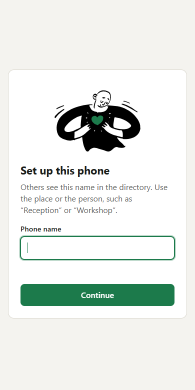
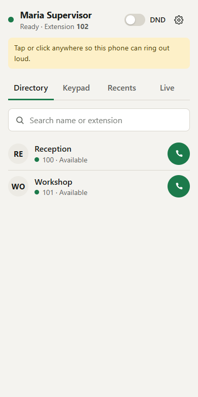
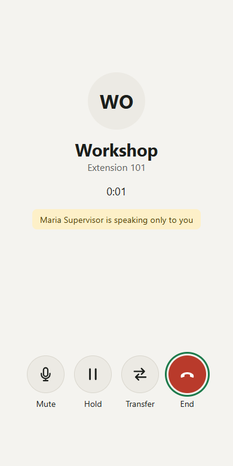
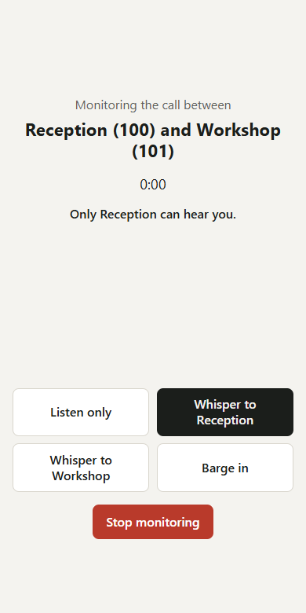
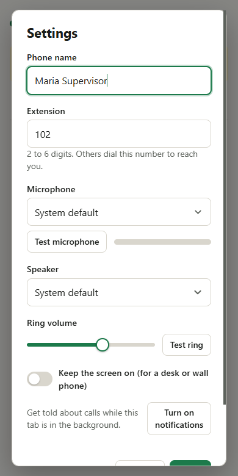
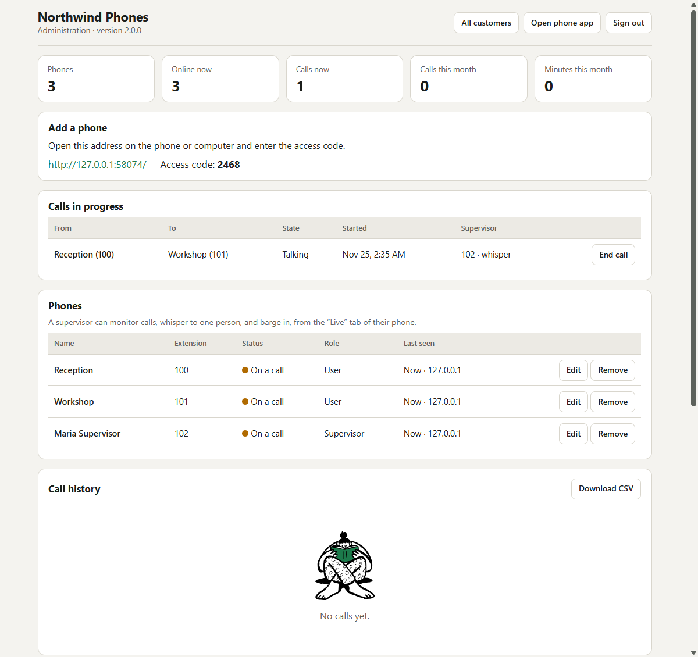
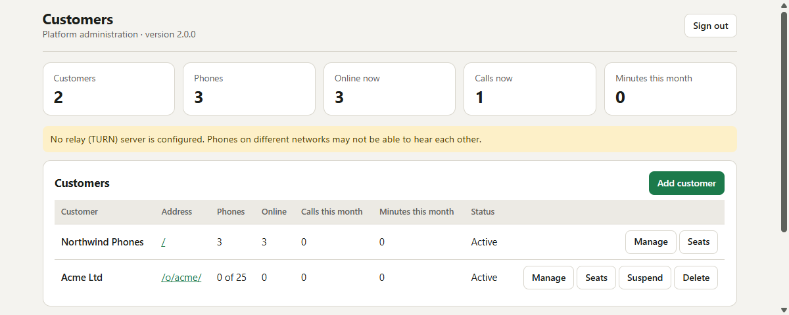

# LAN Call

A telephone system for a local network. One computer runs the server; every other computer, tablet and phone on the network opens a web page and becomes a phone with its own extension number. No internet, no accounts, no apps to install.

Voice travels directly between the two phones, encrypted, and never leaves your network.

## Screenshots

| Set up a phone | Directory | In a call | Supervisor |
| --- | --- | --- | --- |
|  |  |  |  |

Every control is drawn by the app, not the browser: switches, dropdowns, sliders, checkboxes and error messages look the same everywhere.



**Administration console** for one organisation:



**Platform console** for all customers:



## What you get

- **Extensions.** Each phone gets a number (100, 101, …) that it keeps for good. Dial by number or pick a name from the directory.
- **Proper call handling.** Ringing, ringback, busy, declined, no answer, do not disturb, hold, mute, call timer.
- **Missed calls.** Calls to a phone that is busy, switched off or on do-not-disturb are recorded and shown when that phone is next used.
- **Call history** on every phone, and a call log on the server (`data/calls.log`).
- **Stays connected.** A phone that briefly loses Wi-Fi rejoins its call instead of dropping it.
- **Works offline.** Nothing is loaded from the internet.
- **Access code** (optional) so only your people can add a phone.
- **Call transfer.** Pass the person you are talking to on to another extension.
- **Administration console.** Rename, renumber, switch off or remove phones, end calls, see live calls, call history and monthly usage, download the history as CSV.
- **Supervisors.** Chosen phones can monitor a live call, whisper to one person, or barge in.
- **Many customers on one server.** Each gets its own address, phones, extensions, access code, administrator and seat limit, so you can run it as a service.

## Start it

You need [Python 3.11 or newer](https://www.python.org/downloads/) on the computer that will be the server. The first start downloads two Python packages, so that one time it needs internet.

**Windows:** double-click `start_server.bat`.

**Linux / macOS:**

```bash
./start_server.sh
```

The server prints its address:

```
LAN Call 2.0.0 is running.
  Open on any phone or computer:  https://192.168.1.20:8443
  First-time phone setup (trust the certificate):  http://192.168.1.20:8080/setup
```

If other devices cannot reach it, allow ports 8443 and 8080 through the server's firewall (on Windows, `deploy\install-windows.ps1` does this for you).

## Add a phone

1. On the device, open the **setup** address the server printed and follow the steps for that device. This installs the phone system's certificate, once. Browsers only allow the microphone on secure pages, and this is what makes the page secure.
2. Open the main address, type a name for the phone ("Reception", "Workshop"), and allow the microphone when asked.
3. Optional: use the browser's **Install** or **Add to Home Screen** so it opens like an app.

To try it out without step 1, open the main address and click through the browser's warning (**Advanced → Proceed**). Calls work, but background notifications may not, and iPhones are unreliable without the certificate.

**Keep the page open.** A phone can only ring while its page is open. On a computer, a background tab is fine. On a mobile phone the page must be on screen, because mobile systems suspend pages in the background; for a wall or desk phone, turn on *Keep the screen on* in Settings.

## Administration

Open `https://SERVER:8443/admin` and sign in.

**The password.** On first start the server makes one up and writes it to `data/admin-password.txt`. Sign in, change it under Settings, and the file is deleted. Or set your own with `--admin-password` (then it can only be changed there).

In the console you can:

- see who is online and every call in progress, and end a call;
- edit a phone: name, extension, role, or switch it off (it keeps its extension but cannot connect);
- remove a phone (it is signed out and its extension freed);
- read the call history, download it as CSV, and see calls and minutes per month;
- change the name shown on the phones and the access code.

### Supervisors: monitor, whisper, barge

Edit a phone and set its role to **Supervisor**. That phone gets a **Live** tab listing calls in progress. Pressing **Monitor** on one gives four choices, which can be switched at any time:

| Choice | Supervisor hears | Who hears the supervisor |
| --- | --- | --- |
| Listen only | both people | nobody |
| Whisper to … | both people | only the person chosen |
| Barge in | both people | both people |

One supervisor per call. Every use is written into that call's record ("102 whisper to 100").

By default the people on a call see "A supervisor is listening to this call". This can be turned off in Settings. **Listening to calls without telling the people on them is illegal in many places**; turn the notice off only if callers are told another way. A whisper or a barge is always shown to whoever can hear it.

### Transfer

During a call, press **Transfer** and enter an extension. You leave the call and the other person rings that extension.

## Selling it as a service: many customers on one server

Open `https://SERVER/platform` (same password). **Add customer** creates a separate phone system:

- its own address, `https://SERVER/o/<name>/`, which that customer's phones open;
- its own extensions (each customer starts at 100), directory, access code and call history;
- a **seat limit**: the most phones it may add;
- optionally its own administrator password, for `https://SERVER/o/<name>/admin`. That administrator sees and changes only their own organisation.

From the platform console you can also change seats, **suspend** a customer (calls end, phones cannot connect, nothing is deleted) and delete one (its data is moved to `data/deleted/`). The table shows phones, calls and minutes this month per customer, which is what you need for billing. Payment itself is not built in.

For customers outside your own network you need a public host name with a real certificate (run with `--no-tls --trust-proxy` behind a reverse proxy that adds HTTPS) and a relay so phones on different networks can hear each other: `--turn-url` and `--turn-secret`, with a coturn server. `deploy/coolify.py` and `deploy/coolify_turn.py` set both up on a Coolify server.

## Options

Pass options to the start script, or set them as `LANCALL_…` environment variables.

| Option | Default | Meaning |
| --- | --- | --- |
| `--port` | `8443` | HTTPS port. Use `443` so people can leave the port off the address. |
| `--http-port` | `8080` | Plain port for the setup page and certificate download. `0` turns it off. |
| `--pin CODE` | none | Access code a new phone must enter. Phones already added are not asked again. |
| `--name TEXT` | `LAN Call` | Name shown in the app. |
| `--ext-start N` | `100` | First extension number handed out. |
| `--ring-timeout SEC` | `45` | How long a call rings before "no answer". |
| `--prune-days N` | `0` | Remove phones not seen for N days. `0` keeps them forever. |
| `--san NAME` | | Extra name or IP for the certificate, such as `phones.office.lan`. Repeatable. |
| `--cert FILE --key FILE` | | Use your own certificate instead of the built-in one. |
| `--no-tls` | | Serve plain HTTP. Only for use behind a reverse proxy that adds HTTPS. |
| `--admin-password TEXT` | generated | Password for `/admin` and `/platform`. |
| `--trust-proxy` | | Take the caller's address and `https` from the reverse proxy's headers. Only with `--no-tls`, and only when the proxy is the sole way in. |
| `--ice-servers JSON` | none | STUN servers, only needed when phones sit on networks that cannot reach each other directly. |
| `--turn-url URL --turn-secret TEXT` | none | A TURN relay (coturn, `static-auth-secret`) for phones that cannot reach each other at all. Phones get short-lived passwords. |
| `--data-dir DIR` | `data` | Where everything below is stored. |

Example: `start_server.bat --port 443 --http-port 80 --pin 2468 --name "Khan Clinic"`

## Run it permanently

Give the server a **fixed IP address** (a DHCP reservation in your router). The address is what every phone has bookmarked.

**Windows**, from an Administrator PowerShell, after one normal start:

```powershell
powershell -ExecutionPolicy Bypass -File deploy\install-windows.ps1 -Port 443 -HttpPort 80
```

This starts LAN Call with Windows, restarts it if it stops, and opens the firewall for private networks only.

**Linux:** see the steps at the top of `deploy/lancall.service`.

## Files worth knowing

| Path | What it is |
| --- | --- |
| `data/directory.json` | Every phone and its extension. **Back this up.** |
| `data/orgs.json`, `data/orgs/` | Customers, their settings and usage, and each one's phones. **Back this up.** |
| `data/certs/` | The certificate authority and server certificate. **Back this up**, and keep `ca.key` private: if it is lost, every phone must repeat the setup step. |
| `data/calls.log` | One line per call: who, when, how long, how it ended. |
| `data/lancall.log` | Server log. |

`https://SERVER:8443/api/health` reports status for monitoring.

## Troubleshooting

| Problem | Fix |
| --- | --- |
| "Calls are disabled because this page is not secure" | You opened the `http://` address. Use the `https://` one. |
| Browser warns about the certificate | Do the setup step on that device, then restart the browser. |
| Other devices cannot open the page | Firewall on the server (ports above), or the devices are on a guest Wi-Fi that isolates them. |
| The phone does not ring out loud | Click or tap the page once after opening it; browsers mute pages until then. Check ring volume in Settings. |
| Call connects but no sound | Settings → Test microphone on both phones. Check the chosen speaker. |
| "Could not connect the audio between the two phones" | The two devices cannot reach each other directly: client isolation on the Wi-Fi, or a firewall between network segments blocking UDP. |
| "This browser is blocking calls" | A VPN or proxy extension in that browser forbids audio connections. Turn it off for this site or use another browser. |
| The server's IP address changed | The certificate renews itself within five minutes; phones just need the new address. A fixed IP avoids this. |

## What it does not do

It does not connect to the public telephone network or to SIP desk phones, and it has no conference calls, attended transfer, ring groups, call recording, voicemail or paging. Calls are one to one between browsers (plus one supervisor). It does not take payments.

## For developers

```
lancall/        server (Python, aiohttp)
  hub.py        one organisation's exchange: registration, presence, calls, supervision; protocol documented at the top
  tenants.py    organisations, administrator passwords and sessions
  admin.py      administration API
  server.py     HTTPS, WebSocket, routing, security headers
  store.py      phone directory, saved atomically
  certs.py      local certificate authority
web/            the phone (index.html, app.js) and the consoles (admin.html, admin.js); no build step
tests/          protocol, storage and certificate tests; browser test
```

```bash
.venv/Scripts/python -m unittest discover -s tests -t .   # unit and protocol tests
.venv/Scripts/python tests/e2e_browser.py                 # two headless Chrome phones place real calls
```

(On Linux and macOS the interpreter is `.venv/bin/python`.)

## License

MIT. See `LICENSE`.

Illustrations are from [Open Doodles](https://www.opendoodles.com/) by Pablo Stanley (CC0), recoloured. The settings icon is from [Feather](https://feathericons.com/) (MIT).
